# Diez aplicaciones reales que se modelan con problemas NP-Hard

## Una guía visual: de la situación real al algoritmo

Cada aplicación de esta guía describe una situación real, la dibuja, la resuelve a mano en un ejemplo pequeño y muestra qué problema NP-Hard clásico se esconde detrás. Al final de cada caso hay ideas para empezar a diseñar un **algoritmo greedy** y una **búsqueda local**.

Los ejemplos numéricos son inventados para poder revisar las cuentas a mano.

### Las cuatro reglas de oro del modelado

1. **Separar lo que decidimos de lo que sabemos.** La demanda de una clínica es un dato; elegir qué furgón la atiende es una decisión.
2. **Separar reglas obligatorias de preferencias.** Que un furgón no lleve más de lo que cabe es obligatorio. Que un chofer prefiera ciertas rutas es una preferencia: se puede penalizar, pero nunca debe "compensar" romper una regla obligatoria.
3. **Decir exactamente qué versión del problema se resuelve.** Pequeños cambios (¿se puede fraccionar un objeto?, ¿hay que cubrir todo o lo máximo posible?) cambian el problema y los algoritmos.
4. **Demostrar la dificultad con una reducción.** Para mostrar que el problema es NP-Hard, se reduce un problema NP-Hard conocido al nuestro. Que una instancia pequeña sea fácil de resolver a mano no dice nada sobre el caso general.

### Las diez aplicaciones

| Caso | Aplicación | Problema clásico escondido |
|---|---|---|
| 1 | Reparto de medicamentos | TSP, rutas con capacidad |
| 2 | Turnos de personal hospitalario | Set Cover, asignación |
| 3 | Trabajos en una plataforma de cómputo | Makespan, Partición |
| 4 | Selección de pruebas de software | Cobertura máxima, Mochila |
| 5 | Ubicación de servicios de emergencia | Cobertura máxima |
| 6 | Configuración de productos y software | SAT, Mochila |
| 7 | Horarios académicos | Coloreo de grafos |
| 8 | Producción con cambios de herramienta | TSP, scheduling |
| 9 | Campañas de información en redes | Cobertura máxima, influencia |
| 10 | Protección de ecosistemas | Cobertura máxima, conectividad |

---

## 1. Reparto de medicamentos 🚐

### 🎯 La situación

Una distribuidora tiene un depósito y varios furgones. Cada mañana debe llevar medicamentos a varias clínicas. Cada clínica pide una cierta cantidad de cajas y cada furgón tiene espacio limitado. Hay que decidir **qué furgón visita cada clínica y en qué orden**, para que el reparto termine lo antes posible.

### 📋 Problema: Reparto de medicamentos

---

**Entrada**: Un depósito y $n$ clínicas, donde la clínica $i$ pide $q_i$ cajas. $k$ furgones, cada uno con capacidad para $Q$ cajas. El tiempo de viaje $t_{ij}$ entre cada par de lugares $i$ y $j$.

**Restricciones**:

- Cada clínica recibe su pedido completo, de un solo furgón.
- Las cajas que lleva un furgón no pueden superar su capacidad $Q$.
- Cada furgón sale del depósito y vuelve al depósito.

**Objetivo**: Minimizar el tiempo total de viaje, sumando las rutas de todos los furgones.

**Salida**: Una ruta para cada furgón (la secuencia de clínicas que visita) que cumpla las restricciones y tenga el menor tiempo total.

---

> 🔑 **Lo que decidimos:** qué clínicas atiende cada furgón y en qué orden. **Lo que sabemos:** pedidos, capacidades y tiempos de viaje.

### 🖼️ El problema dibujado

Dos furgones de capacidad **5 cajas** y tres clínicas. Los números en las flechas son minutos de viaje.

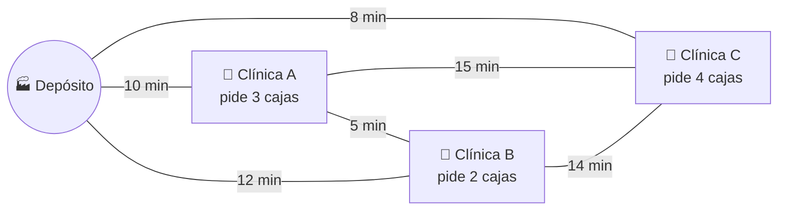

### ✅ Una solución a mano

**Solución válida:** el furgón 1 hace Depósito → A → B → Depósito y el furgón 2 hace Depósito → C → Depósito.

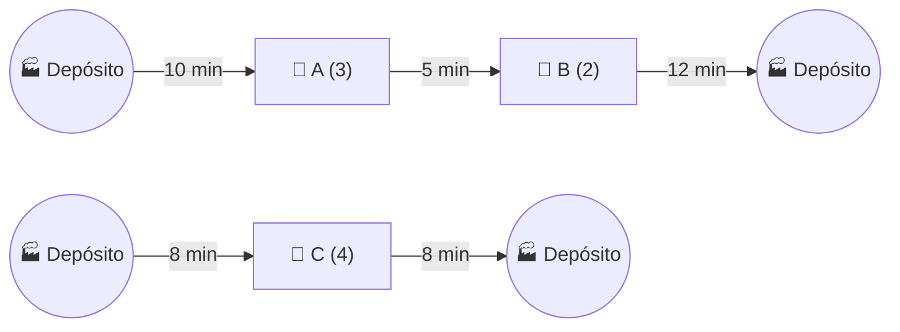

| Furgón | Ruta | Carga | Tiempo |
|---|---|---|---|
| 1 | Depósito → A → B → Depósito | 3 + 2 = **5 de 5** ✅ | 10 + 5 + 12 = **27 min** |
| 2 | Depósito → C → Depósito | **4 de 5** ✅ | 8 + 8 = **16 min** |
| | | **Total** | **43 min** |

**Solución inválida:** juntar A y C en un furgón. La ruta podría parecer corta, pero 3 + 4 = **7 cajas > 5**: no caben. Esta solución rompe una regla obligatoria, así que no sirve aunque fuera más rápida.

> 💡 Fíjate que el costo de atender una clínica **depende de con quién se agrupa y en qué orden**. Por eso no basta con decidir "qué furgón", también importa "en qué orden".

### 🧱 El problema clásico escondido

Si simplificamos la situación (**un solo furgón**, sin límite de capacidad), el problema se convierte exactamente en el **TSP**: recorrer todas las clínicas y volver al depósito con el menor tiempo posible.

### Problema: TSP (NP-Hard)

---

**Entrada**: Un grafo completo no dirigido $G=(V,E)$ y un costo $c_e$ para cada arco $e \in E$.

**Salida**: Un tour (ciclo que pasa una sola vez por cada vértice) de costo mínimo.

---

| Elemento real | Elemento del TSP |
|---|---|
| Depósito y clínicas | Ciudades (vértices) |
| Tiempo de viaje entre dos lugares | Costo de un arco |
| Ruta del furgón | Tour |

**Idea para la reducción (TSP → Reparto):** dada cualquier instancia del TSP, se crea una instancia del reparto con una ciudad como depósito, las demás como clínicas que piden 1 caja, un solo furgón con capacidad n y los tiempos iguales a los costos del TSP. Existe un tour de costo ≤ L si y solo si existe un plan de reparto de tiempo ≤ L. Como el TSP es NP-Hard, el reparto también lo es.

### 🛠️ Ideas para resolverlo

**Greedy (vecino más cercano con capacidad):** el furgón sale del depósito y va a la clínica más cercana **cuyo pedido aún quepa**. Cuando ninguna clínica cabe, vuelve al depósito y sale el siguiente furgón.

**Movimientos para la búsqueda local:**

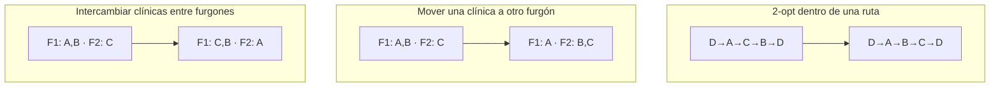

Cada movimiento solo se acepta si la nueva solución respeta la capacidad y reduce el tiempo total.

### ⚠️ Lo que el modelo no captura

Ventanas horarias de las clínicas, tráfico, medicamentos que necesitan cadena de frío y entregas urgentes que no pueden esperar. Cada una se puede agregar como restricción, pero hace el problema más difícil de resolver.

**Referencia:** Toth, P., y Vigo, D. (eds.). (2014). *Vehicle Routing: Problems, Methods, and Applications*. 2.ª edición. SIAM. [DOI](https://doi.org/10.1137/1.9781611973594). Capítulos 1, 5 y 10: rutas con capacidad, ventanas de tiempo y visitas opcionales. El ejemplo y sus cifras son una adaptación didáctica.


---

## 2. Turnos de personal hospitalario 🏥

### 🎯 La situación

Un hospital debe cubrir los turnos de la semana. Cada turno necesita cierta cantidad de personas y cada trabajador solo puede trabajar en los turnos en que está disponible, respetando reglas de descanso. Convocar a un trabajador para la semana tiene un costo, así que el hospital quiere **cubrir todos los turnos convocando a la menor cantidad posible de personas**.

### 📋 Problema: Asignación de turnos

---

**Entrada**: Un conjunto de turnos, donde el turno $r$ necesita $d_r$ personas. $n$ trabajadores, donde el trabajador $e$ tiene un conjunto de turnos en los que está disponible y puede trabajar como máximo $h_e$ turnos en la semana.

**Restricciones**:

- Cada turno $r$ queda cubierto por al menos $d_r$ personas.
- Un trabajador solo es asignado a turnos en los que está disponible y a no más de $h_e$ turnos.
- Un trabajador hace como máximo un turno por día.
- Un trabajador no puede hacer un turno de mañana justo después de un turno de noche.

**Objetivo**: Minimizar la cantidad de trabajadores convocados (que reciben al menos un turno).

**Salida**: Los turnos asignados a cada trabajador, de modo que se cumplan las restricciones con la menor cantidad de trabajadores convocados.

---

> 🔑 **Lo que decidimos:** qué turnos hace cada trabajador. **Lo que sabemos:** la demanda de cada turno, la disponibilidad y el máximo de turnos de cada persona.

### 🖼️ El problema dibujado

Cuatro turnos que necesitan **una persona cada uno** y cuatro trabajadores que pueden hacer hasta 2 turnos. Las líneas punteadas indican en qué turnos está disponible cada persona.

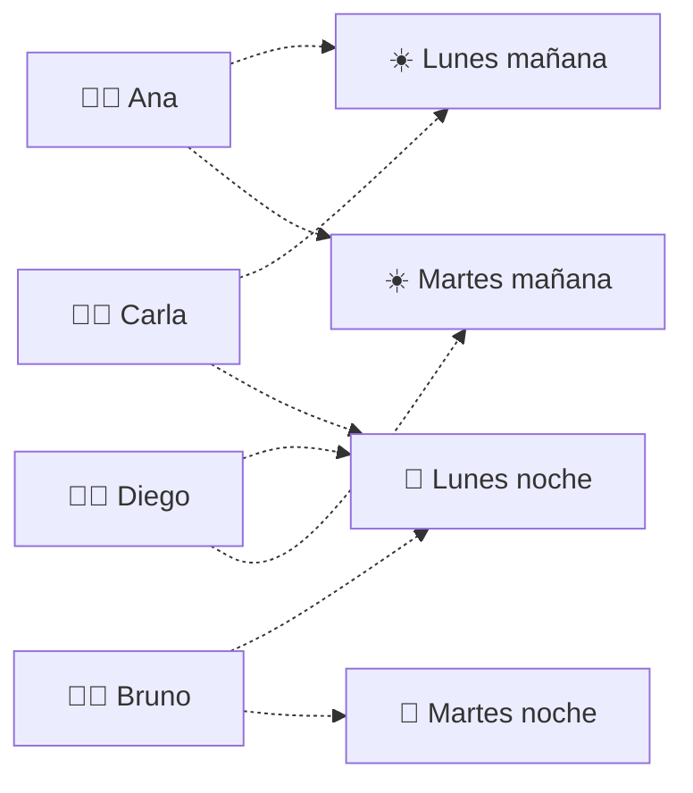

### ✅ Una solución a mano

**Solución óptima:** convocar solo a Ana y Bruno. Ana cubre las mañanas y Bruno las noches: **2 personas convocadas**.

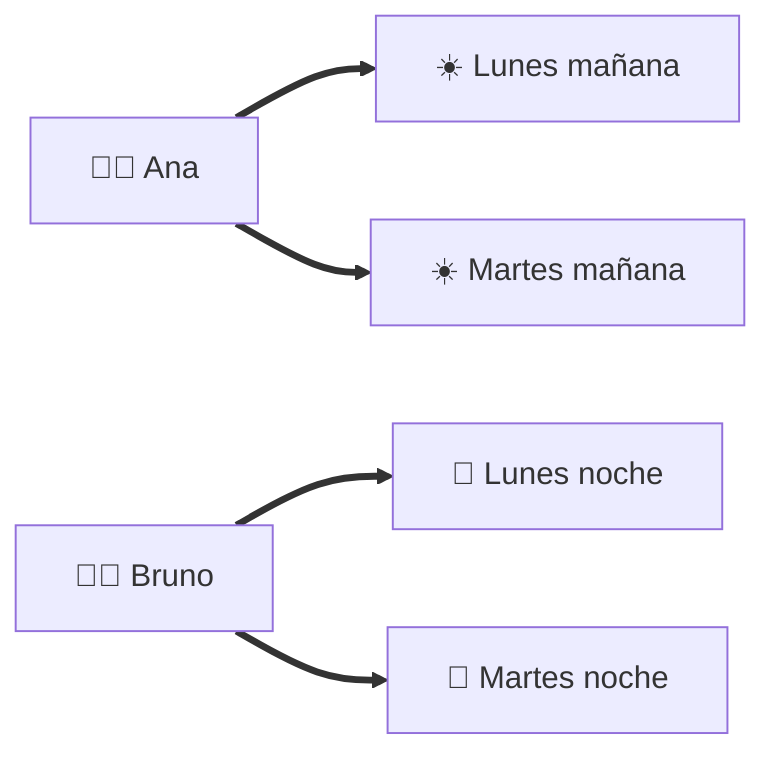

| Trabajador | Turnos | ¿Cumple las reglas? |
|---|---|---|
| Ana | Lunes mañana, Martes mañana | ✅ un turno por día |
| Bruno | Lunes noche, Martes noche | ✅ nunca hace mañana después de noche |

**Soluciones inválidas:**

- Carla cubre Lunes mañana y Lunes noche: parece eficiente, pero rompe la regla de **un turno por día** ❌.
- Diego cubre Lunes noche y Martes mañana: rompe la regla de **descanso** (mañana justo después de noche) ❌.

> 💡 La disponibilidad dice qué turnos *podría* hacer una persona, pero las reglas de descanso limitan qué combinaciones de turnos son válidas. Por eso Carla y Diego, que parecen tan útiles como Ana o Bruno, no lo son.

### 🧱 El problema clásico escondido

Si cada turno necesita una sola persona y las reglas de descanso nunca se activan, convocar a la menor cantidad de trabajadores para cubrir todos los turnos es el problema de **Set Cover**.

### Problema: Set Cover (NP-Hard)

---

**Entrada**: Un universo $U$ de elementos y una colección de subconjuntos $S_1, S_2, ..., S_m$ de $U$.

**Salida**: La menor cantidad de subconjuntos cuya unión es $U$.

---

| Elemento real | Elemento de Set Cover |
|---|---|
| Turnos de la semana | Elementos del universo $U$ |
| Turnos en que está disponible un trabajador | Un subconjunto $S_i$ |
| Convocar a un trabajador | Elegir un subconjunto |

**Idea para la reducción (Set Cover → Turnos):** cada elemento de $U$ se convierte en un turno de mañana en un día distinto, con demanda 1. Cada subconjunto $S_i$ se convierte en un trabajador disponible exactamente en esos turnos, con máximo $h_i = |S_i|$. Como todos los turnos son de mañana y en días distintos, las reglas de descanso nunca se activan. Existe una cobertura con a lo más $k$ subconjuntos si y solo si se pueden cubrir los turnos convocando a lo más $k$ trabajadores.

### 🛠️ Ideas para resolverlo

**Greedy:** convocar al trabajador que pueda cubrir **la mayor cantidad de turnos aún descubiertos** respetando las reglas, asignarle esos turnos y repetir hasta cubrir todo (o hasta que nadie pueda cubrir los turnos que faltan).

**Movimientos para la búsqueda local:**

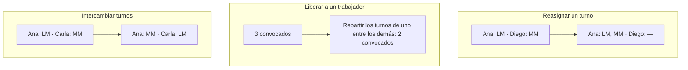

> 💡 Para que la búsqueda local pueda pasar por soluciones intermedias, la función objetivo puede ser "trabajadores convocados + una penalización grande por cada turno descubierto". Así, una solución con un turno descubierto siempre es peor que cualquier solución completa.

### ⚠️ Lo que el modelo no captura

Competencias distintas (enfermería, técnicos, especialistas), preferencias de turno, equidad entre trabajadores a lo largo de varias semanas (quién hace más noches o fines de semana) y ausencias de último minuto.

**Referencias:**

- Ernst, A. T., Jiang, H., Krishnamoorthy, M., y Sier, D. (2004). "Staff scheduling and rostering: A review of applications, methods and models". *European Journal of Operational Research*, 153(1), 3–27. [DOI](https://doi.org/10.1016/S0377-2217%2803%2900095-X). Revisión de planificación de personal, con aplicaciones en salud.
- Pinedo, M. L. (2022). *Scheduling: Theory, Algorithms, and Systems*. 6.ª edición. Springer. [DOI](https://doi.org/10.1007/978-3-031-05921-6).

El ejemplo de Ana, Bruno, Carla y Diego fue creado para esta guía.

---

## 3. Trabajos en una plataforma de cómputo 🖥️

### 🎯 La situación

Una plataforma recibe trabajos de procesamiento (por ejemplo, entrenar modelos o generar reportes). Cada trabajo tarda un tiempo conocido y se ejecuta completo en un solo servidor. Hay que decidir **en qué servidor se ejecuta cada trabajo** para que todo termine lo antes posible.

### 📋 Problema: Asignación de trabajos a servidores

---

**Entrada**: $n$ trabajos con duraciones $l_1, l_2, ..., l_n$ y $m$ servidores idénticos.

**Restricciones**:

- Cada trabajo se ejecuta completo en un solo servidor.
- Un servidor ejecuta un trabajo a la vez.

**Objetivo**: Minimizar el **makespan**, es decir, el momento en que termina el último trabajo. Equivale a la carga del servidor más cargado.

**Salida**: Una asignación de cada trabajo a un servidor que minimice el makespan.

---

> 🔑 **Lo que decidimos:** en qué servidor se ejecuta cada trabajo. **Lo que sabemos:** las duraciones y la cantidad de servidores.

### 🖼️ El problema dibujado

Cuatro trabajos de **8, 7, 6 y 5 minutos** y **dos servidores** idénticos. La carga total es 26 minutos, así que en el mejor caso cada servidor trabaja 13 minutos.

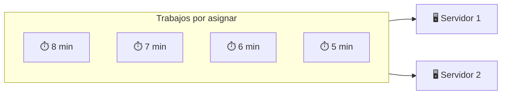

### ✅ Una solución a mano

**Solución óptima:** agrupar 8 + 5 y 7 + 6. Ambos servidores terminan en el minuto 13.

```mermaid
gantt
    title Solución óptima: makespan 13 min
    dateFormat X
    axisFormat %S
    section Servidor 1
    Trabajo de 8 min :0, 8
    Trabajo de 5 min :8, 13
    section Servidor 2
    Trabajo de 7 min :0, 7
    Trabajo de 6 min :7, 13
```

**Solución peor:** si los trabajos llegan en orden 5, 6, 7, 8 y cada uno se envía al servidor menos cargado (algoritmo de Graham), el resultado es 5 + 7 = 12 y 6 + 8 = **14 minutos**.

```mermaid
gantt
    title Graham en orden 5, 6, 7, 8: makespan 14 min
    dateFormat X
    axisFormat %S
    section Servidor 1
    Trabajo de 5 min :0, 5
    Trabajo de 7 min :5, 12
    section Servidor 2
    Trabajo de 6 min :0, 6
    Trabajo de 8 min :6, 14
```

> 💡 Si primero se ordenan los trabajos de mayor a menor (algoritmo LPT, visto en clases), el greedy encuentra la solución óptima en este ejemplo.

### 🧱 El problema clásico escondido

Con **dos servidores**, preguntar si el makespan puede ser exactamente la mitad de la carga total es el problema de **Partición**: ¿se puede dividir un conjunto de números en dos grupos de igual suma?

### Problema: Partición (NP-Hard)

---

**Entrada**: Un conjunto de $n$ enteros positivos $a_1, a_2, ..., a_n$.

**Respuesta**: "SI", si los números se pueden dividir en dos grupos con la misma suma. "NO", en caso contrario.

---

| Elemento real | Elemento de Partición |
|---|---|
| Duración de cada trabajo | Cada número del conjunto |
| Servidor 1 y servidor 2 | Grupo 1 y grupo 2 |
| Makespan = carga total / 2 | Ambos grupos suman lo mismo |

**Idea para la reducción (Partición → Makespan):** dados los números de Partición, se crea un trabajo por número y dos servidores. Los números se pueden partir en dos grupos de igual suma si y solo si existe una asignación con makespan ≤ suma total / 2.

### 🛠️ Ideas para resolverlo

**Greedy:** algoritmo LPT, ordenar los trabajos de mayor a menor duración y asignar cada uno al servidor menos cargado.

**Movimientos para la búsqueda local:**

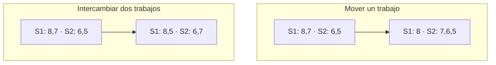

> 💡 Muchas soluciones distintas tienen el mismo makespan, lo que puede "estancar" la búsqueda local. Un truco es desempatar con una segunda medida, por ejemplo la suma de los cuadrados de las cargas, que premia las soluciones más equilibradas.

### ⚠️ Lo que el modelo no captura

Trabajos que necesitan GPU y solo pueden ir a ciertos servidores, límites de memoria cuando varios trabajos corren a la vez, trabajos que dependen de otros y duraciones que en la práctica son solo estimaciones.

**Referencias:**

- Pinedo, M. L. (2022). *Scheduling: Theory, Algorithms, and Systems*. 6.ª edición. Springer. [DOI](https://doi.org/10.1007/978-3-031-05921-6). Modelos de máquinas paralelas y makespan.
- Verma, A., Pedrosa, L., Korupolu, M. R., Oppenheimer, D., Tune, E., y Wilkes, J. (2015). "Large-scale cluster management at Google with Borg". *Proceedings of EuroSys*, artículo 18. [DOI](https://doi.org/10.1145/2741948.2741964). Sistema real de gestión de clústeres; no implica que use este modelo simplificado.


---

## 4. Selección de pruebas de software 🧪

### 🎯 La situación

Antes de publicar una nueva versión de una aplicación, el equipo tiene solo unos minutos para ejecutar pruebas automáticas. Cada prueba tarda un tiempo distinto y verifica ciertas funcionalidades (login, pagos, búsqueda…). No alcanza el tiempo para ejecutarlas todas, así que hay que **elegir qué pruebas ejecutar para verificar las funcionalidades más importantes**.

### 📋 Problema: Selección de pruebas

---

**Entrada**: $n$ pruebas, donde la prueba $i$ tarda $d_i$ minutos y verifica un conjunto de funcionalidades. $m$ funcionalidades, donde la funcionalidad $j$ tiene una importancia $w_j$. Un tiempo disponible $B$.

**Restricciones**:

- La suma de las duraciones de las pruebas elegidas no puede superar $B$.
- Las pruebas marcadas como obligatorias siempre se ejecutan.

**Objetivo**: Maximizar la importancia total de las funcionalidades verificadas. Una funcionalidad verificada por dos pruebas se cuenta una sola vez.

**Salida**: El conjunto de pruebas a ejecutar.

---

> 🔑 **Lo que decidimos:** qué pruebas ejecutar. **Lo que sabemos:** duraciones, qué verifica cada prueba, la importancia de cada funcionalidad y el tiempo disponible.

### 🖼️ El problema dibujado

Tres pruebas, cuatro funcionalidades de igual importancia y **8 minutos** disponibles.

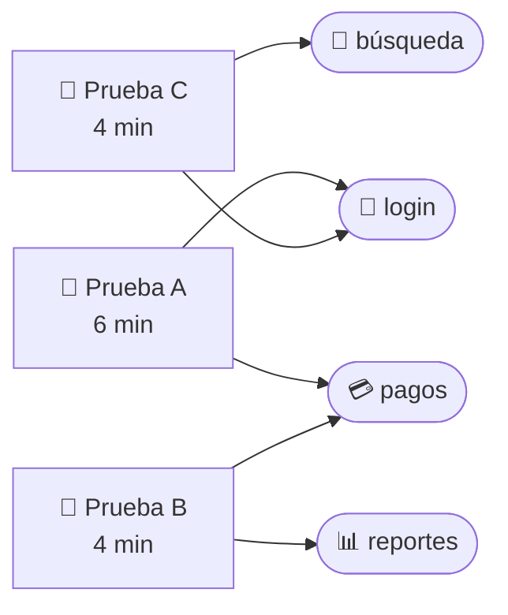

### ✅ Una solución a mano

**Solución óptima:** ejecutar B y C. Tardan 4 + 4 = **8 minutos** ✅ y verifican **las 4 funcionalidades**.

| Selección | Tiempo | Funcionalidades verificadas |
|---|---|---|
| B + C | 8 min ✅ | login, pagos, reportes, búsqueda → **4** |
| A sola | 6 min ✅ | login, pagos → **2** (no cabe ninguna otra prueba) |
| A + B | 10 min ❌ | supera el tiempo disponible |

> 💡 Las tres pruebas verifican 2 funcionalidades cada una. Un greedy que solo mira "cuántas funcionalidades verifica" no puede distinguirlas y, si elige A primero, se queda con 2. Un greedy que mira **funcionalidades nuevas por minuto** elige B o C (2/4 = 0,5) antes que A (2/6 ≈ 0,33) y llega al óptimo.

### 🧱 El problema clásico escondido

Si todas las pruebas duran lo mismo y todas las funcionalidades valen lo mismo, elegir $k$ pruebas que verifiquen la mayor cantidad de funcionalidades es el problema de **Cobertura Máxima** (*Maximum Coverage*).

### Problema: Cobertura Máxima (NP-Hard)

---

**Entrada**: Un universo $U$ de elementos, una colección de subconjuntos $S_1, S_2, ..., S_m$ de $U$ y un entero $k$.

**Salida**: $k$ subconjuntos cuya unión contenga la mayor cantidad posible de elementos.

---

| Elemento real | Elemento de Cobertura Máxima |
|---|---|
| Funcionalidades | Elementos del universo $U$ |
| Funcionalidades que verifica una prueba | Un subconjunto $S_i$ |
| Tiempo disponible $B$ (con pruebas de 1 minuto) | Cantidad $k$ de subconjuntos |

**Idea para la reducción (Cobertura Máxima → Selección de pruebas):** cada elemento de $U$ se convierte en una funcionalidad de importancia 1 y cada subconjunto $S_i$ en una prueba de 1 minuto que verifica esos elementos. El tiempo disponible es $B = k$. Existen $k$ subconjuntos que cubren al menos $t$ elementos si y solo si existe una selección de pruebas que verifica al menos $t$ funcionalidades.

### 🛠️ Ideas para resolverlo

**Greedy:** partir con las pruebas obligatorias y agregar repetidamente la prueba con mayor **importancia nueva verificada por minuto** que aún quepa en el tiempo disponible.

**Movimientos para la búsqueda local:**

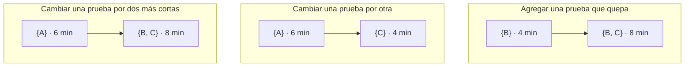

### ⚠️ Lo que el modelo no captura

Verificar una funcionalidad no garantiza que esté libre de errores. Además, hay pruebas inestables que fallan al azar, pruebas que dependen de otras y equipos que ejecutan varias pruebas en paralelo (lo que mezcla este problema con el de makespan del caso 3).


**Referencia:** Yoo, S., y Harman, M. (2012). "Regression testing minimization, selection and prioritization: a survey". *Software Testing, Verification and Reliability*, 22(2), 67–120. [DOI](https://doi.org/10.1002/stvr.430). Revisión de minimización, selección y priorización de pruebas. El presupuesto y el ejemplo son construcciones didácticas.


---

## 5. Ubicación de servicios de emergencia 🚑

### 🎯 La situación

Una ciudad quiere instalar bases de ambulancias. Hay varias ubicaciones posibles y cada una alcanza, dentro del tiempo máximo de respuesta (por ejemplo, 8 minutos), a ciertos barrios. El presupuesto permite abrir pocas bases, así que hay que **elegir dónde instalarlas para que la mayor cantidad de personas quede cubierta**.

### 📋 Problema: Ubicación de bases de emergencia

---

**Entrada**: $n$ barrios, donde el barrio $j$ tiene $d_j$ habitantes. $m$ ubicaciones candidatas, donde cada ubicación alcanza un conjunto de barrios dentro del tiempo máximo de respuesta. Un número máximo $p$ de bases a abrir.

**Restricciones**:

- Se abren como máximo $p$ bases.
- Un barrio está cubierto si al menos una base abierta lo alcanza.

**Objetivo**: Maximizar la cantidad de habitantes cubiertos. Un barrio alcanzado por dos bases se cuenta una sola vez.

**Salida**: El conjunto de ubicaciones donde se abren bases.

---

> 🔑 **Lo que decidimos:** dónde abrir bases. **Lo que sabemos:** la población de cada barrio y qué barrios alcanza cada ubicación.

### 🖼️ El problema dibujado

Cuatro barrios, tres ubicaciones candidatas y presupuesto para **2 bases**. Las flechas indican qué barrios alcanza cada ubicación en menos de 8 minutos.

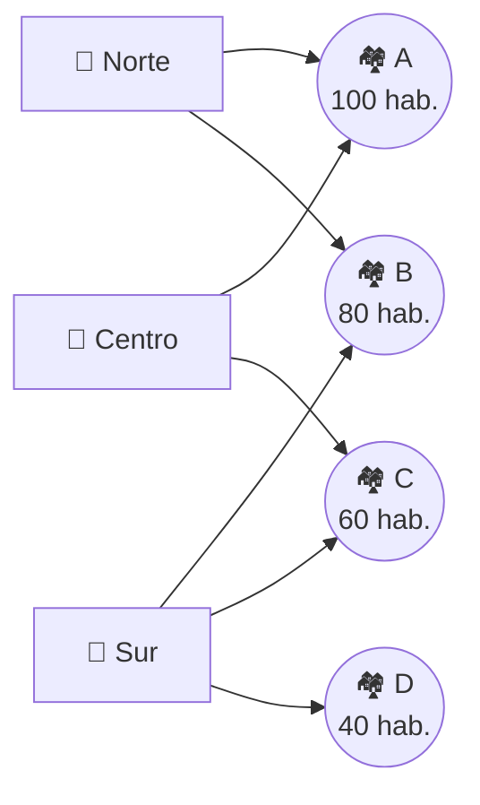

### ✅ Una solución a mano

**Solución óptima:** abrir Norte y Sur. Entre ambas alcanzan los cuatro barrios: **280 habitantes**.

| Bases abiertas | Barrios cubiertos | Habitantes |
|---|---|---|
| Norte + Sur | A, B, C, D | 100 + 80 + 60 + 40 = **280** ✅ |
| Norte + Centro | A, B, C | 100 + 80 + 60 = **240** |
| Sur + Centro | A, B, C, D | **280** ✅ |

> 💡 Norte y Sur cubren 180 habitantes cada una por separado, pero juntas no cubren 360: el barrio B está en ambas y **se cuenta una sola vez**. Sumar las coberturas individuales sobreestima el resultado.

### 🧱 El problema clásico escondido

Si todos los barrios tienen la misma población, elegir $p$ ubicaciones que cubran la mayor cantidad de barrios es exactamente el problema de **Cobertura Máxima**, el mismo del caso 4.

### Problema: Cobertura Máxima (NP-Hard)

---

**Entrada**: Un universo $U$ de elementos, una colección de subconjuntos $S_1, S_2, ..., S_m$ de $U$ y un entero $k$.

**Salida**: $k$ subconjuntos cuya unión contenga la mayor cantidad posible de elementos.

---

| Elemento real | Elemento de Cobertura Máxima |
|---|---|
| Barrios | Elementos del universo $U$ |
| Barrios que alcanza una ubicación | Un subconjunto $S_i$ |
| Número máximo de bases $p$ | Cantidad $k$ de subconjuntos |

**Idea para la reducción (Cobertura Máxima → Ubicación de bases):** cada elemento de $U$ se convierte en un barrio de 1 habitante y cada subconjunto $S_i$ en una ubicación que alcanza esos barrios, con $p = k$. Existen $k$ subconjuntos que cubren al menos $t$ elementos si y solo si se pueden abrir $p$ bases que cubran al menos $t$ habitantes.

### 🛠️ Ideas para resolverlo

**Greedy:** abrir repetidamente la base que cubra **la mayor cantidad de habitantes aún no cubiertos**, hasta abrir $p$ bases. En el ejemplo: primero Norte (180), luego Sur (agrega 100) en vez de Centro (agrega solo 60).

**Movimientos para la búsqueda local:**

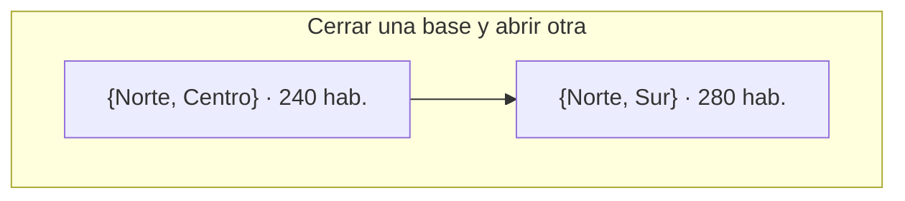

> 💡 Con un solo tipo de movimiento, la búsqueda local puede quedarse atrapada. Probar distintos órdenes, o reiniciar desde soluciones iniciales aleatorias (restarts), ayuda a encontrar mejores soluciones.

### ⚠️ Lo que el modelo no captura

Las bases tienen capacidad limitada (una base ocupada no responde a una segunda llamada), el tráfico cambia los tiempos de viaje y maximizar la población total puede dejar siempre sin cobertura a un barrio pequeño y aislado. Para esto último se puede exigir una cobertura mínima por sector.


**Referencia:** Church, R., y ReVelle, C. (1974). "The maximal covering location problem". *Papers in Regional Science*, 32, 101–118. [DOI](https://doi.org/10.1111/j.1435-5597.1974.tb00902.x). Formulación clásica de localización de cobertura máxima; capacidad y equidad son extensiones.


---

## 6. Configuración de productos y software 🧩

### 🎯 La situación

Un cliente arma su plan de software eligiendo módulos opcionales. Cada módulo tiene un costo y aporta cierto valor al cliente, pero hay reglas: algunos módulos **requieren** otros para funcionar y algunos son **incompatibles** entre sí. El cliente tiene un presupuesto, y la empresa quiere **recomendar la configuración válida de mayor valor**.

### 📋 Problema: Configuración de módulos

---

**Entrada**: $n$ módulos, donde el módulo $i$ cuesta $c_i$ y aporta un valor $v_i$. Un presupuesto $B$. Un conjunto de reglas de dos tipos: dependencias ("el módulo $a$ requiere al módulo $b$") e incompatibilidades ("los módulos $a$ y $b$ no pueden ir juntos").

**Restricciones**:

- El costo total de los módulos elegidos no puede superar $B$.
- Si se elige un módulo, también deben elegirse todos los módulos que requiere.
- No se pueden elegir dos módulos incompatibles.

**Objetivo**: Maximizar el valor total de los módulos elegidos.

**Salida**: El conjunto de módulos de la configuración.

---

> 🔑 **Lo que decidimos:** qué módulos incluir. **Lo que sabemos:** costos, valores, presupuesto y reglas.

### 🖼️ El problema dibujado

Tres módulos y un presupuesto de **7**. Las flechas sólidas son dependencias y la línea punteada es una incompatibilidad.

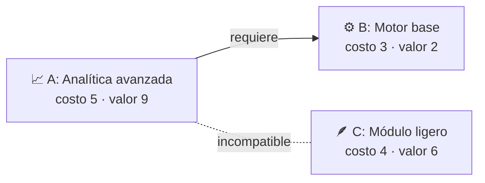

### ✅ Una solución a mano

**Solución óptima:** elegir B y C. Cuesta 3 + 4 = **7** ✅, no hay incompatibilidades y su valor es **8**.

| Configuración | Costo | Valor | ¿Válida? |
|---|---|---|---|
| B + C | 7 | **8** | ✅ |
| A + B | 8 | 11 | ❌ supera el presupuesto |
| A sola | 5 | 9 | ❌ A requiere B |
| A + C | 9 | 15 | ❌ incompatibles y supera el presupuesto |
| C sola | 4 | 6 | ✅ pero peor que B + C |

> 💡 Si solo miramos el valor de cada módulo, A parece la mejor elección (valor 9). Pero A arrastra a B por su dependencia y juntos superan el presupuesto. Las reglas hacen que el valor de un módulo **no pueda evaluarse aisladamente**.

### 🧱 El problema clásico escondido

Si eliminamos todas las reglas, elegir módulos de mayor valor sin superar el presupuesto es exactamente el problema de la **Mochila**.

### Problema: Mochila 0/1 (NP-Hard)

---

**Entrada**: $n$ objetos, donde el objeto $i$ tiene un peso $w_i$ y un valor $v_i$, y una capacidad $W$.

**Salida**: Un subconjunto de objetos con peso total a lo más $W$ y valor total máximo.

---

| Elemento real | Elemento de la Mochila |
|---|---|
| Módulos | Objetos |
| Costo de un módulo | Peso de un objeto |
| Presupuesto $B$ | Capacidad $W$ |

**Idea para la reducción (Mochila → Configuración):** cada objeto se convierte en un módulo con costo igual a su peso y el mismo valor, sin dependencias ni incompatibilidades, y con presupuesto $B = W$. Existe un subconjunto de objetos de valor al menos $V$ si y solo si existe una configuración válida de valor al menos $V$.

> 📌 Las reglas también agregan dificultad por sí solas: con reglas lógicas generales ("si se elige A, se debe elegir B o C"), decidir si existe al menos una configuración válida ya contiene al problema **SAT**.

### 🛠️ Ideas para resolverlo

**Greedy:** tratar cada módulo junto con todo lo que requiere como un **paquete** (sumando costos y valores). En cada paso, agregar el paquete con mayor **valor por unidad de costo** que quepa en el presupuesto y no sea incompatible con lo ya elegido. En el ejemplo, el paquete {A, B} tiene valor 11 y costo 8: no cabe, así que el greedy pasa a C y luego a B.

**Movimientos para la búsqueda local:**

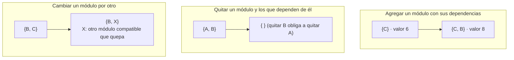

Cada movimiento debe verificar el presupuesto y las reglas antes de aceptarse.

### ⚠️ Lo que el modelo no captura

Descuentos por paquete, módulos que solo aportan valor cuando van juntos, versiones y licencias, y el consumo real de recursos (memoria, energía) que puede imponer otros límites además del presupuesto.


**Referencia:** Sinz, C., Kaiser, A., y Küchlin, W. (2003). "Formal methods for the validation of automotive product configuration data". *AI EDAM*, 17(1), 75–97. [DOI](https://doi.org/10.1017/S0890060403171065). Validación de configuraciones automotrices con SAT; la optimización con presupuesto es una extensión didáctica.


---

## 7. Horarios académicos 📅

### 🎯 La situación

Una escuela debe asignar un bloque horario a cada curso del semestre. Si dos cursos comparten estudiantes o profesor, **no pueden dictarse en el mismo bloque**. Además, en cada bloque hay una cantidad limitada de salas. Se quiere **armar el horario usando la menor cantidad de bloques**, para dejar espacio libre en la semana.

### 📋 Problema: Asignación de bloques horarios

---

**Entrada**: $n$ cursos. Una lista de pares de cursos en conflicto (comparten estudiantes o profesor). Una cantidad $s$ de salas disponibles en cada bloque.

**Restricciones**:

- Dos cursos en conflicto no pueden quedar en el mismo bloque.
- En un mismo bloque no puede haber más de $s$ cursos.

**Objetivo**: Minimizar la cantidad de bloques horarios utilizados.

**Salida**: El bloque asignado a cada curso.

---

> 🔑 **Lo que decidimos:** en qué bloque va cada curso. **Lo que sabemos:** qué pares de cursos están en conflicto y cuántas salas hay.

### 🖼️ El problema dibujado

El problema se dibuja como un **grafo de conflictos**: cada curso es un nodo y cada conflicto es una arista. Hay cinco cursos y **2 salas** por bloque.

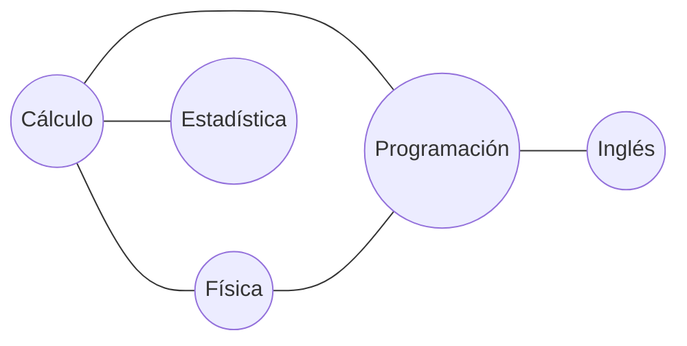

### ✅ Una solución a mano

**Solución óptima:** **3 bloques**. Cada color es un bloque y ningún par de cursos unidos por una arista comparte color.

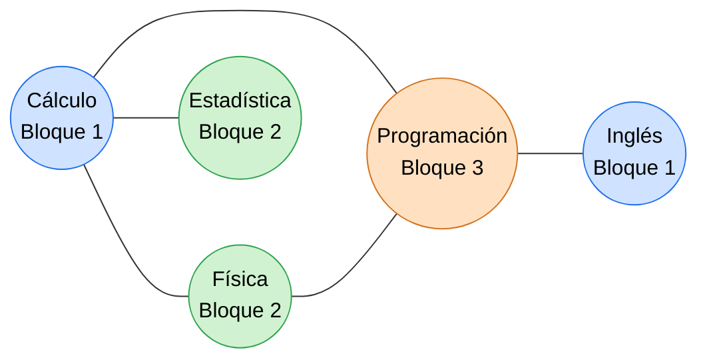

| Bloque | Cursos | Salas usadas |
|---|---|---|
| 1 | Cálculo, Inglés | 2 de 2 ✅ |
| 2 | Física, Estadística | 2 de 2 ✅ |
| 3 | Programación | 1 de 2 ✅ |

No se puede hacer con 2 bloques: Cálculo, Física y Programación están en conflicto entre sí (forman un triángulo), así que necesitan tres bloques distintos.

**Solución inválida:** poner Cálculo y Física en el mismo bloque ❌. Los estudiantes que toman ambos cursos tendrían un choque de horario.

### 🧱 El problema clásico escondido

Si hay salas suficientes, asignar bloques a cursos sin choques usando la menor cantidad de bloques es el problema de **Coloreo de grafos**: los bloques son colores.

### Problema: Coloreo de grafos (NP-Hard)

---

**Entrada**: Un grafo no dirigido $G=(V,E)$ y un entero $k$.

**Respuesta**: "SI", si se puede asignar uno de $k$ colores a cada vértice de modo que dos vértices unidos por una arista tengan colores distintos. "NO", en caso contrario.

---

| Elemento real | Elemento del Coloreo |
|---|---|
| Cursos | Vértices |
| Conflicto entre dos cursos | Arista |
| Bloque horario | Color |

**Idea para la reducción (Coloreo → Horarios):** cada vértice se convierte en un curso, cada arista en un conflicto, y se dejan $s = n$ salas por bloque para que la capacidad nunca limite. El grafo se puede colorear con $k$ colores si y solo si existe un horario que usa a lo más $k$ bloques.

### 🛠️ Ideas para resolverlo

**Greedy:** ordenar los cursos de **mayor a menor cantidad de conflictos** y asignar cada uno al primer bloque donde no choque con nadie y quede sala libre. Una variante más astuta (DSATUR) elige en cada paso el curso cuyos vecinos ya usan más bloques distintos.

**Movimientos para la búsqueda local:** se fija una cantidad de bloques $k$ y se minimiza la cantidad de choques. Si se llega a 0 choques, se intenta con $k-1$ bloques.

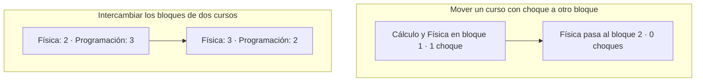

### ⚠️ Lo que el modelo no captura

Cursos con varias sesiones por semana, disponibilidad de los profesores, salas de distinto tamaño (laboratorios, auditorios), preferencias por ciertos horarios y la decisión previa de qué cursos abrir.


**Referencia:** Schaerf, A. (1999). "A survey of automated timetabling". *Artificial Intelligence Review*, 13, 87–127. [DOI](https://doi.org/10.1023/A:1006576209967). Revisión de horarios escolares, universitarios y de exámenes.


---

## 8. Producción con cambios de herramienta 🏭

### 🎯 La situación

Una fábrica produce varios pedidos en una misma máquina. Entre un pedido y el siguiente hay que limpiar o cambiar herramientas, y ese tiempo de preparación **depende del par de pedidos**: pasar de pintura blanca a gris es rápido, pero de negra a blanca requiere una limpieza larga. Hay que **decidir el orden de los pedidos para terminar lo antes posible**.

### 📋 Problema: Secuenciación con tiempos de preparación

---

**Entrada**: $n$ pedidos, donde el pedido $j$ tarda $p_j$ horas en procesarse. Para cada par de pedidos $i$ y $j$, un tiempo de preparación $s_{ij}$ si $j$ se procesa inmediatamente después de $i$. Este tiempo puede ser distinto de $s_{ji}$.

**Restricciones**:

- Cada pedido se procesa exactamente una vez y sin interrupciones.
- La máquina procesa un pedido a la vez.
- Entre dos pedidos consecutivos se debe realizar la preparación correspondiente.

**Objetivo**: Minimizar el momento en que termina el último pedido. Como los tiempos de procesamiento son fijos, equivale a minimizar la suma de los tiempos de preparación.

**Salida**: El orden en que se procesan los pedidos.

---

> 🔑 **Lo que decidimos:** el orden de los pedidos. **Lo que sabemos:** los tiempos de procesamiento y de preparación.

### 🖼️ El problema dibujado

Tres pedidos de **2 horas** cada uno. Las flechas indican el tiempo de preparación para pasar de un pedido a otro (en ese sentido).

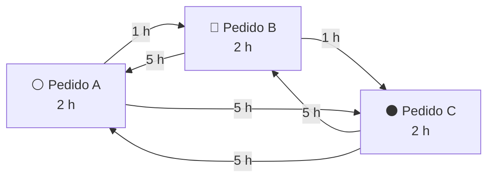

### ✅ Una solución a mano

**Solución óptima:** A → B → C, con dos preparaciones cortas. Termina en **8 horas**.

```mermaid
gantt
    title A → B → C: termina en 8 horas
    dateFormat X
    axisFormat %S
    section Máquina
    Pedido A :0, 2
    Preparación :crit, 2, 3
    Pedido B :3, 5
    Preparación :crit, 5, 6
    Pedido C :6, 8
```

**Solución peor:** A → C → B usa dos preparaciones largas y termina en **16 horas**.

```mermaid
gantt
    title A → C → B: termina en 16 horas
    dateFormat X
    axisFormat %S
    section Máquina
    Pedido A :0, 2
    Preparación :crit, 2, 7
    Pedido C :7, 9
    Preparación :crit, 9, 14
    Pedido B :14, 16
```

> 💡 Como los tiempos de preparación no son simétricos, C → B → A (5 + 5 = 10 horas de preparación) es mucho peor que A → B → C, aunque visiten los mismos pedidos en orden inverso.

### 🧱 El problema clásico escondido

Ordenar los pedidos minimizando las preparaciones es buscar un **camino que pase una vez por cada pedido** con el menor costo: es la versión de camino del **TSP**, el mismo problema del caso 1 (sin volver al punto de partida).

| Elemento real | Elemento del TSP |
|---|---|
| Pedidos | Ciudades (vértices) |
| Tiempo de preparación entre dos pedidos | Costo de un arco |
| Orden de producción | Camino que visita todas las ciudades |

**Idea para la reducción (TSP → Secuenciación):** dada una instancia del TSP, se elige una ciudad inicial y se crea un pedido por cada ciudad, más una copia del pedido de la ciudad inicial. Todos los pedidos tardan lo mismo y las preparaciones son los costos del TSP: $s_{ij} = c_{ij}$, y la preparación hacia la copia es el costo de volver a la ciudad inicial. Las preparaciones que llegan al pedido inicial o salen de su copia se fijan enormes, para obligar a que la secuencia empiece en la ciudad inicial y termine en su copia. Así, existe un tour de costo a lo más $L$ si y solo si existe un orden de producción cuyas preparaciones suman a lo más $L$.

### 🛠️ Ideas para resolverlo

**Greedy (vecino más cercano):** comenzar con el pedido que tenga la preparación de salida más barata y elegir siempre como siguiente el pedido pendiente con **menor tiempo de preparación** desde el actual.

**Movimientos para la búsqueda local:**

```mermaid
flowchart TB
    subgraph M1["Intercambiar dos pedidos"]
        direction LR
        a1["A → C → B · 10 h prep."] --> a2["A → B → C · 2 h prep."]
    end
    subgraph M2["Mover un pedido a otra posición"]
        direction LR
        b1["B → C → A · 6 h prep."] --> b2["A → B → C · 2 h prep."]
    end
```

> 💡 El movimiento 2-opt del TSP invierte un tramo de la secuencia. Con preparaciones asimétricas, invertir un tramo cambia el costo de todos sus arcos, así que conviene recalcularlos con cuidado.

### ⚠️ Lo que el modelo no captura

Fechas de entrega comprometidas (el orden más eficiente puede atrasar un pedido urgente), varias máquinas, mantenimientos programados, averías y materiales que no están disponibles desde el inicio.


**Referencias:**

- Allahverdi, A., Ng, C. T., Cheng, T. C. E., y Kovalyov, M. Y. (2008). "A survey of scheduling problems with setup times or costs". *European Journal of Operational Research*, 187(3), 985–1032. [DOI](https://doi.org/10.1016/j.ejor.2006.06.060). Scheduling con tiempos de preparación.
- Pinedo, M. L. (2022). *Scheduling: Theory, Algorithms, and Systems*. 6.ª edición. Springer. [DOI](https://doi.org/10.1007/978-3-031-05921-6).


---

## 9. Campañas de información en redes 📣

### 🎯 La situación

Una institución quiere difundir información de salud pública a través de promotores: personas u organizaciones que llegan directamente a cierto público (sus seguidores, vecinos o estudiantes). Contactar a cada promotor tiene un costo y el presupuesto es limitado. Hay que **elegir a qué promotores contactar para llegar a la mayor cantidad de personas**.

### 📋 Problema: Selección de promotores

---

**Entrada**: $n$ promotores, donde el promotor $i$ cuesta $c_i$ y llega directamente a un conjunto de personas. Un presupuesto $B$.

**Restricciones**:

- El costo total de los promotores elegidos no puede superar $B$.

**Objetivo**: Maximizar la cantidad de personas alcanzadas. Una persona alcanzada por dos promotores se cuenta una sola vez.

**Salida**: El conjunto de promotores a contactar.

---

> 🔑 **Lo que decidimos:** a qué promotores contactar. **Lo que sabemos:** el costo de cada promotor, a quiénes llega y el presupuesto.

### 🖼️ El problema dibujado

Tres promotores de igual costo y presupuesto para **2 promotores**. Las flechas indican a qué personas llega cada uno.

```mermaid
flowchart LR
    A["📢 Promotor A"]
    B["📢 Promotor B"]
    C["📢 Promotor C"]
    A --> P1(("1")) & P2(("2")) & P3(("3")) & P4(("4"))
    B --> P3 & P4 & P5(("5")) & P6(("6"))
    C --> P7(("7")) & P8(("8")) & P9(("9"))
```

### ✅ Una solución a mano

| Promotores elegidos | Personas alcanzadas | Total |
|---|---|---|
| A + B | 1, 2, 3, 4, 5, 6 | **6** |
| A + C | 1, 2, 3, 4, 7, 8, 9 | **7** ✅ |
| B + C | 3, 4, 5, 6, 7, 8, 9 | **7** ✅ |

**Solución óptima:** A + C (o B + C) alcanza **7 personas**.

> 💡 Elegir "los dos promotores con más audiencia" (A y B, con 4 cada uno) da solo 6 personas, porque A y B **comparten** a las personas 3 y 4. Lo que importa es cuántas personas **nuevas** aporta cada promotor.

### 🧱 El problema clásico escondido

Con costos iguales, elegir $k$ promotores que alcancen la mayor cantidad de personas es el problema de **Cobertura Máxima**, el mismo de los casos 4 y 5.

### Problema: Cobertura Máxima (NP-Hard)

---

**Entrada**: Un universo $U$ de elementos, una colección de subconjuntos $S_1, S_2, ..., S_m$ de $U$ y un entero $k$.

**Salida**: $k$ subconjuntos cuya unión contenga la mayor cantidad posible de elementos.

---

| Elemento real | Elemento de Cobertura Máxima |
|---|---|
| Personas | Elementos del universo $U$ |
| Personas a las que llega un promotor | Un subconjunto $S_i$ |
| Presupuesto (con promotores de costo 1) | Cantidad $k$ de subconjuntos |

**Idea para la reducción (Cobertura Máxima → Selección de promotores):** cada elemento de $U$ se convierte en una persona y cada subconjunto $S_i$ en un promotor de costo 1 que llega a esas personas, con presupuesto $B = k$. Existen $k$ subconjuntos que cubren al menos $t$ elementos si y solo si existe una selección de promotores que alcanza al menos $t$ personas.

### 🛠️ Ideas para resolverlo

**Greedy:** agregar repetidamente al promotor con mayor cantidad de **personas nuevas alcanzadas por unidad de costo** que quepa en el presupuesto. En el ejemplo: primero A (4 nuevas), luego C (3 nuevas) en vez de B (solo 2 nuevas).

**Movimientos para la búsqueda local:**

```mermaid
flowchart TB
    subgraph M1["Cambiar un promotor por otro"]
        direction LR
        a1["{A, B} · 6 personas"] --> a2["{A, C} · 7 personas"]
    end
    subgraph M2["Cambiar un promotor caro por dos baratos"]
        direction LR
        b1["{X} · costo 2"] --> b2["{Y, Z} · costo 1 + 1"]
    end
```

### ⚠️ Lo que el modelo no captura

Las personas alcanzadas pueden **retransmitir** la información a otras (efecto cascada), lo que cambia completamente el problema y requiere modelos con probabilidades. Además, maximizar el total puede dejar sin información a grupos pequeños, por lo que puede exigirse un mínimo por comunidad.


- x_i = 1 si se contacta al promotor i; y_j = 1 si la persona j es alcanzada.
- Presupuesto: Σ_i c_i · x_i ≤ B.
- Alcance: y_j ≤ Σ_i a_ij · x_i, con a_ij = 1 si el promotor i llega a la persona j.
- Maximizar Σ_j y_j.

**Referencia:** Kempe, D., Kleinberg, J., y Tardos, É. (2015). "Maximizing the Spread of Influence through a Social Network". *Theory of Computing*, 11(4), 105–147. [DOI](https://doi.org/10.4086/toc.2015.v011a004). [Acceso abierto](https://www.theoryofcomputing.org/articles/v011a004/). Modelos de difusión en cascada, su NP-dificultad y garantías del greedy.


---

## 10. Protección de ecosistemas 🌳

### 🎯 La situación

Una fundación ambiental tiene presupuesto para comprar y proteger parcelas de terreno. Cada parcela tiene un costo y alberga ciertas especies. Se quiere **elegir las parcelas que protegen la mayor cantidad de especies** sin superar el presupuesto. En una versión más exigente, las parcelas protegidas deben estar **conectadas** para que los animales puedan moverse entre ellas.

### 📋 Problema: Selección de áreas protegidas

---

**Entrada**: $n$ parcelas, donde la parcela $i$ cuesta $c_i$ y alberga un conjunto de especies. Un presupuesto $B$. (Opcional) Un grafo que indica qué parcelas son vecinas.

**Restricciones**:

- El costo total de las parcelas elegidas no puede superar $B$.
- (Versión con conectividad) Las parcelas elegidas deben formar una sola zona conectada en el grafo de vecindad.

**Objetivo**: Maximizar la cantidad de especies protegidas. Una especie presente en dos parcelas elegidas se cuenta una sola vez.

**Salida**: El conjunto de parcelas a proteger.

---

> 🔑 **Lo que decidimos:** qué parcelas proteger. **Lo que sabemos:** costos, especies de cada parcela, presupuesto y vecindades.

### 🖼️ El problema dibujado

Tres parcelas en línea y presupuesto **6**. La parcela P3 es un corredor: no alberga especies de la lista, pero conecta P1 con P2.

```mermaid
flowchart LR
    P1["🌲 P1 · costo 3<br/>especies A, B"]
    P3["🌾 P3 · costo 2<br/>corredor, sin especies"]
    P2["🌲 P2 · costo 3<br/>especies C, D"]
    P1 --- P3 --- P2
```

### ✅ Una solución a mano

**Sin conectividad:** elegir P1 y P2. Cuesta 3 + 3 = **6** ✅ y protege **4 especies**.

```mermaid
flowchart LR
    P1["🌲 P1 ✅<br/>A, B"]
    P3["🌾 P3"]
    P2["🌲 P2 ✅<br/>C, D"]
    P1 --- P3 --- P2
    classDef sel fill:#d1f2d1,stroke:#2da44e,color:#000
    class P1,P2 sel
```

**Con conectividad:** P1 y P2 ya no sirven solas, porque no son vecinas. Para unirlas hace falta P3, y P1 + P3 + P2 cuesta **8 > 6** ❌. La mejor opción conectada dentro del presupuesto es P1 o P2 sola (más P3 si se quiere), con solo **2 especies**.

| Selección | Costo | Especies | ¿Conectada? |
|---|---|---|---|
| P1 + P2 | 6 ✅ | 4 | ❌ |
| P1 + P3 + P2 | 8 ❌ | 4 | ✅ |
| P1 | 3 ✅ | 2 | ✅ |

> 💡 El corredor P3 no aporta ninguna especie, pero tiene **valor estructural**: sin él la solución no es conectada. Un greedy que solo cuenta especies nuevas nunca lo elegiría.

### 🧱 El problema clásico escondido

Sin conectividad y con costos iguales, elegir $k$ parcelas que protejan la mayor cantidad de especies es el problema de **Cobertura Máxima**, el mismo de los casos 4, 5 y 9.

### Problema: Cobertura Máxima (NP-Hard)

---

**Entrada**: Un universo $U$ de elementos, una colección de subconjuntos $S_1, S_2, ..., S_m$ de $U$ y un entero $k$.

**Salida**: $k$ subconjuntos cuya unión contenga la mayor cantidad posible de elementos.

---

| Elemento real | Elemento de Cobertura Máxima |
|---|---|
| Especies | Elementos del universo $U$ |
| Especies que alberga una parcela | Un subconjunto $S_i$ |
| Presupuesto (con parcelas de costo 1) | Cantidad $k$ de subconjuntos |

**Idea para la reducción (Cobertura Máxima → Áreas protegidas, sin conectividad):** cada elemento de $U$ se convierte en una especie y cada subconjunto $S_i$ en una parcela de costo 1 que alberga esas especies, con presupuesto $B = k$. Existen $k$ subconjuntos que cubren al menos $t$ elementos si y solo si existe una selección de parcelas que protege al menos $t$ especies.

### 🛠️ Ideas para resolverlo

**Greedy (sin conectividad):** agregar repetidamente la parcela con más **especies nuevas por unidad de costo** que quepa en el presupuesto.

**Greedy (con conectividad):** partir de una parcela inicial y agregar solo parcelas **vecinas** a las ya elegidas, prefiriendo las que aportan más especies nuevas por costo. Un corredor sin especies puede valer la pena si abre el acceso a parcelas valiosas.

**Movimientos para la búsqueda local:**

```mermaid
flowchart TB
    subgraph M1["Cambiar una parcela por otra"]
        direction LR
        a1["{…, Pi}"] --> a2["{…, Pj}<br/>si cabe en el presupuesto y protege más especies"]
    end
    subgraph M2["Quitar una parcela y agregar otra en el borde"]
        direction LR
        b1["Zona conectada"] --> b2["Zona conectada que se desplaza hacia parcelas valiosas"]
    end
```

En la versión con conectividad, cada movimiento debe verificar que la zona siga conectada.

### ⚠️ Lo que el modelo no captura

Que una especie esté presente no garantiza que su población sea viable. Además, importan la calidad del hábitat, las barreras reales (caminos, ríos) que impiden la conectividad, los incendios y el cambio climático.


**Referencia:** Williams, J. C., ReVelle, C. S., y Levin, S. A. (2005). "Spatial attributes and reserve design models: A review". *Environmental Modeling & Assessment*, 10, 163–181. [DOI](https://doi.org/10.1007/s10666-005-9007-5). Selección de reservas con atributos espaciales como la conectividad.


---

## ✔️ Lista de revisión para modelar tu propio problema

1. ¿Qué decisiones se toman y cuáles son los datos?
2. ¿Cuáles son las entradas, las restricciones obligatorias, el objetivo y la salida?
3. ¿Qué preferencias pueden penalizarse sin romper una restricción obligatoria?
4. ¿Las cantidades se suman, o hay superposiciones (como una persona alcanzada dos veces)?
5. ¿Tienes un ejemplo pequeño que puedas resolver y verificar a mano?
6. ¿Qué problema NP-Hard conocido se reduce a tu problema? ¿Cómo son el preproceso y el postproceso?
7. ¿Qué hace tu algoritmo si la instancia no tiene solución factible?
8. ¿Qué parte de la realidad deja fuera tu modelo?

## 📚 Referencias generales

- Roughgarden, T. *Algorithms Illuminated, Part 4: Algorithms for NP-Hard Problems*. Problemas fundacionales, reducciones y algoritmos para problemas NP-Hard.
- Kleinberg, J., y Tardos, É. (2005). *Algorithm Design*. Pearson/Addison-Wesley. Modelado, NP-completitud y aproximación.
- Garey, M. R., y Johnson, D. S. (1979). *Computers and Intractability: A Guide to the Theory of NP-Completeness*. W. H. Freeman.
- Wolsey, L. A. (1998). *Integer Programming*. Wiley. Formulación y resolución de modelos matemáticos como los de las secciones plegadas.

Los escenarios y ejemplos numéricos fueron elaborados para esta guía. Las referencias de cada caso documentan las familias de modelos y aplicaciones relacionadas; no atribuyen a sus autores estas cifras ni las simplificaciones aquí propuestas. Las ideas de reducción son esquemas didácticos: una demostración formal debe verificar que la transformación respete exactamente las restricciones de la variante analizada.
